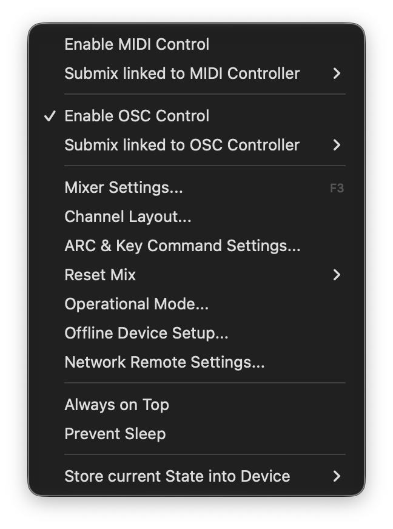
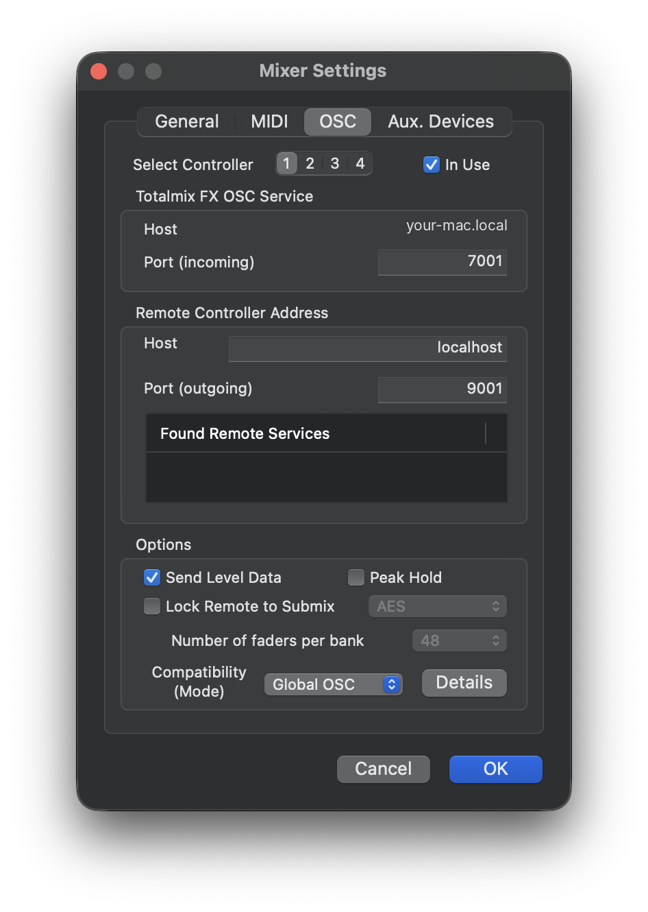
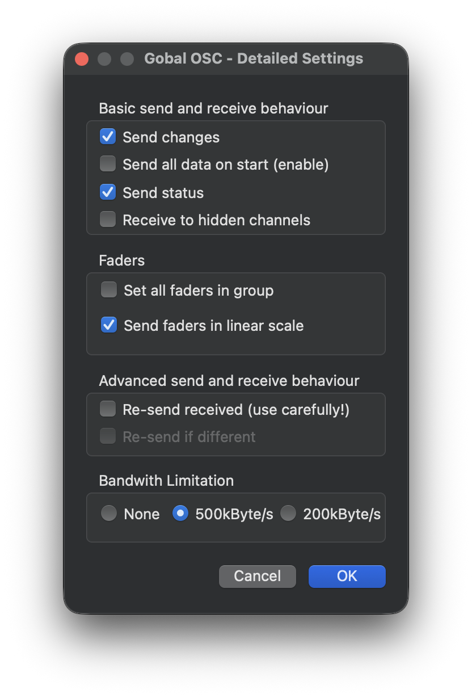
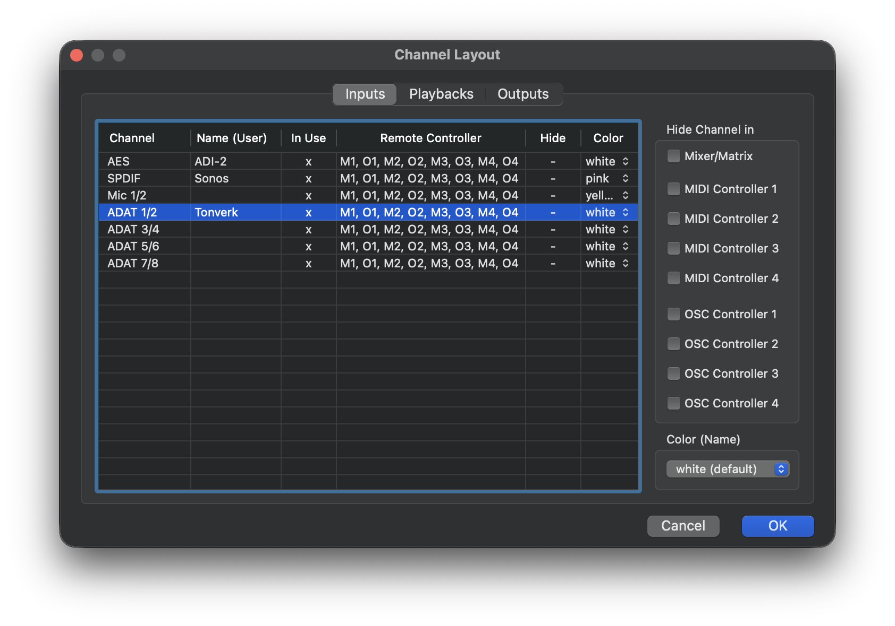

# Setting up Performance Bridge

This guide sets up Performance Bridge with TotalMix FX and a Roto-Control. There is no released app yet:
the app runs from source, with `swift run PerformanceBridge`, or is built with `./make-app.sh`
(README, "Trying the app"). The steps below
mark what has been checked on a Mac and what has not.

**Checked.** The settings in each step were used in the tests in `docs/TOTALMIX-OSC.md` (section 6) and
`docs/ROTO-CONTROL.md` (section 9), with the versions named there: TotalMix FX "2.10 (1)" with a Digiface AES,
and a Roto-Control on firmware 3.3.0.

**Not checked on screen.** Where a menu path or a label below comes from RME's manual or the project's
notes and has not been seen in TotalMix, the step says so.

## What you need

- A Mac running macOS 13 or later.
- TotalMix FX 2.1 or later (release candidates are fine), on a supported RME interface. Earlier versions don't have Global OSC; the setup window checks the version. The project has tested a Digiface AES only.
- A Roto-Control, connected to the Mac by USB. The project has tested firmware 3.3.0.
- The Swift toolchain (Xcode, or the Command Line Tools with Swift 5.9 or later), to run the app from source.

The app has a setup window that follows these steps and checks each one live where it can: whether
TotalMix FX answers, whether it has sent its channels, whether meters arrive, and whether the
Roto-Control is connected. It opens by itself the first time the app runs; after that, choose
**Setup Guide…** from the menu.

The window also opens by itself, at most once per launch, for a problem that has never worked with
the current settings: the port in use; TotalMix FX running but not answering for 30 seconds; or the
Roto-Control plugged in but not connected after 15 seconds. A Roto-Control that isn't plugged in,
or TotalMix FX not running, never opens it. Once a connection has worked, a fault only puts a red dot
on the menu-bar icon, so a window never takes the focus during a performance. The dot is for faults:
the port in use, TotalMix FX running but silent for 10 seconds, or the Roto-Control plugged in but
not connected for 10 seconds. TotalMix FX closed, or the Roto-Control unplugged, is idle and leaves
no dot, so the app can run all the time. The icon is dimmed whenever TotalMix FX or the Roto-Control
isn't connected and drawn normally when both are; a fault shows the red dot on the dimmed icon.

## Step 1: Turn on Global OSC in TotalMix FX

Checked on screen with TotalMix FX "2.10 (1)" on a Mac (Adam, 2026-10-31); the screenshots are from it.

1. Open TotalMix FX's **Options** menu and check **Enable OSC Control**. (RME's online manual calls the item
   "Enable MIDI / OSC Control", docs.rme-audio.com/aoxd/818-1c_menu_options/; the running TotalMix shows "Enable
   OSC Control" and a separate "Enable MIDI Control".)

   

2. Choose **Options → Mixer Settings…** (shortcut F3) and open the **OSC** tab.
3. Under **Select Controller**, choose a controller (1–4) for Performance Bridge and check **In Use**.
   - Each program or device that connects to TotalMix FX over OSC (Performance Bridge, a tablet app, another
     remote) needs its own controller and its own ports (Adam, 2026-10-31).
   - Controller 1 is shown below, with incoming 7001 and outgoing 9001. If another program already uses
     controller 1, choose another controller and give it ports no other controller uses (for example, 7002 and
     9002).
4. Under **Compatibility (Mode)**, choose **Global OSC**.
5. Set the ports:
   - **Port (incoming)**, under "Totalmix FX OSC Service" (TotalMix's capitalization), is where Performance
     Bridge sends to TotalMix. The **Host** above it is your Mac's own name, shown for reference.
   - Under **Remote Controller Address**, **Host** is the computer Performance Bridge runs on (`localhost` or
     `127.0.0.1` on the same Mac), and **Port (outgoing)** is where TotalMix sends to Performance Bridge.
   - Enter the same two ports in Performance Bridge's **Settings… → Connections**. Its defaults are 7001 and
     9001, which RME's manual gives as typical values. To try other ports without changing Settings, start the
     app with `--in-port` and `--out-port`.

   

6. Under **Options**, check **Send Level Data** for meters on the hardware controllers and leave **Lock Remote
   to Submix** off (Performance Bridge chooses submixes itself). The effect of **Number of faders per bank** on
   the app has not been tested.
7. Click **Details**, which opens "Gobal OSC - Detailed Settings" (TotalMix's spelling), and check **Send
   changes** and **Send status**. The other settings shown are the ones used in the tests: "Send all data on
   start (enable)" off, "Receive to hidden channels" off, "Set all faders in group" off, "Send faders in linear
   scale" on (TotalMix accepts both scales, test 2), "Re-send received (use carefully!)" off, and "Bandwith
   Limitation" (TotalMix's spelling) at 500kByte/s. Whether the app needs
   any of them set a certain way has not been tested.

   

8. **Options → Submix linked to OSC Controller** is a submenu with one item per controller, 1 to 4; all four
   were checked on Adam's Mac. RME's Global OSC document says "Follow Submix" should be off with Global OSC;
   this submenu is inferred to be that setting, since TotalMix has no item by that name. The tests ran with it
   checked, and it made no difference to what Global OSC sends (`docs/TOTALMIX-OSC.md`, section 1), so there is
   no reason to change it.

## Step 2: Choose which channels the hardware controllers show

Hide and show channels in TotalMix FX; Performance Bridge has no setting for hiding. A channel that TotalMix
hides from an OSC Controller is not shown on the hardware controllers connected through it, and the app does
not show it greyed out. Checked on screen (Adam, 2026-10-31) unless marked otherwise.

1. Open TotalMix FX's own **Channel Layout** window: right-click a channel's strip and choose **Change Channel
   Layout**, or choose **Options → Channel Layout…**. It has tabs for Inputs, Playbacks, and Outputs.
2. Select the channel's row. Under **Hide Channel in**, check the **OSC Controller** box for the controller
   Performance Bridge uses (OSC Controller 1 for controller 1). Hiding from one controller doesn't affect the
   others, or Mixer/Matrix.
3. Channel colors can be set in the same window, in the **Color** column or with **Color (Name)** below the
   boxes. The Roto-Control shows them too.

   

4. Then choose **Refresh Channels from TotalMix FX** in Performance Bridge's menu: TotalMix doesn't announce
   hidden or shown channels over OSC (`docs/TOTALMIX-OSC.md`, test 11). The app also refreshes by itself when
   its Channel Layout tab opens.

The table's **Remote Controller** column lists M1–M4 and O1–O4 for each channel when nothing is hidden; what it
shows for a hidden channel has not been checked. Hiding has been seen not to renumber the other channels (one
run).

## Step 3: Connect the Roto-Control

1. Connect the Roto-Control to the Mac by USB. It can be connected before or after the app starts.
2. The app finds the Roto-Control by the name of its MIDI port. The default, "Roto", matches the port
   named "Roto-Control". To choose another port, open Settings (Connections tab) and pick it from the MIDI port menu under
   Roto-Control; the menu lists the ports connected when Settings opens.

## Step 4: Start the app

From the package folder:

```
swift run PerformanceBridge
```

To use ports other than the saved ones, add them to the command line:

```
swift run PerformanceBridge --in-port 7004 --out-port 9004
```

The menu-bar icon's menu starts with two status lines, dimmed because they only report. The app keeps
retrying in every state:

- **TotalMix FX: Connected** means TotalMix has answered. **No Answer** means it has not yet; the app asks
  again every 3 seconds. **Port N in Use** means another program has the port the app sends from, so quit
  that program, such as `sbdev`.
- **Roto-Control: Connected** means the handshake is complete. **Connecting** means the device was found and
  the handshake is under way. **Not Found** means no MIDI port matches the one in Settings.

The full reason for any state goes to the log in the Terminal the app was started from.

After hiding or showing channels in TotalMix FX's own Channel Layout window, choose **Refresh Channels from
TotalMix FX** from the menu: TotalMix doesn't announce those changes over OSC (`docs/TOTALMIX-OSC.md`, test 11).
The app also refreshes by itself when its Channel Layout tab opens and when TotalMix FX comes back after
going quiet.

## Step 5: Set the layout

Choose **Settings…** from the menu and open the **Channel Layout** tab.

- The **Sources** and **Outputs** buttons switch between the two views.
- Drag a channel to change its place on the hardware controllers. In the Outputs view, the **Control Room** outputs (those
  assigned in TotalMix FX's control room: Main Out, Phones, and so on) and the **Hardware Outputs** are ordered in their
  own sections, since control room outputs always come first.
- **Restore TotalMix FX Order** puts the view back in TotalMix FX's order. It appears only when the order differs from TotalMix FX's.
- To take a channel off the hardware controllers, hide it in TotalMix (Step 2). The layout has no hide setting of its own.
- Channel colors can be set in TotalMix FX's own Channel Layout window (the Color column and the Color (Name) menu for the selected channel). Checked on screen (Adam, 2026-10-31).
- The note at the bottom repeats the rule for channels hidden in TotalMix.
- **Playbacks start on a new page**, under the Sources list, puts the first playback at the start of a new
  page of strips, after blank strips that fill the inputs' last page.

## Step 6: Choose the mix output

The mix output is the output whose submix the hardware controllers' levels and pans go into. Choose it from the
menu, under **Mix Output**.

- Main Out is the default. Choosing Main Out's output saves "follow Main Out", so the mix output moves when
  Main Out is reassigned in TotalMix.
- Any other output is in the **Hardware Outputs** submenu of the same menu.

## If something does not work

- **TotalMix FX: Port N in Use.** Another program has the port. Quit `sbdev` or any other OSC remote.
- **TotalMix FX: No Answer.** Check that Global OSC is on and that the ports in Settings match TotalMix's
  (Step 1). Then choose **Refresh Channels from TotalMix FX**.
- **Roto-Control: Not Found.** Check the cable and the MIDI port in Settings (Step 3).
- **A channel is missing from the hardware controllers.** Check whether TotalMix hides it from the OSC controller the app uses
  (Step 2).

## Reporting a problem

Keep the Terminal's log: the app writes every connection event to it. The log is the record to send
with a report.
