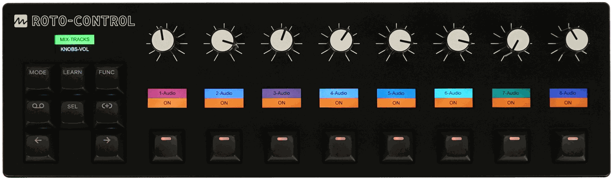
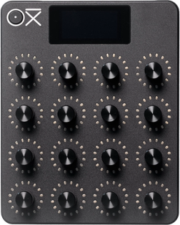
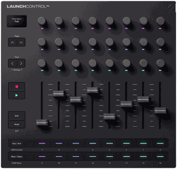
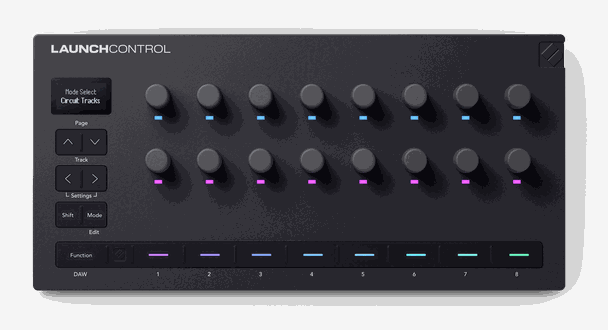

# Setting up Performance Bridge

## What you need

- A Mac running macOS 13 or later.
- TotalMix FX 2.1 or later (release candidates included), on a supported RME interface. Earlier versions don't have Global OSC; the Setup Guide checks the version. Tested only with a Digiface AES.
- A hardware controller, connected to the Mac by USB: a Roto-Control (tested with firmware 3.3.0), a Launch
  Control XL 3 (tested with firmware 1.2), or a Launch Control 3 (not yet tried on a device).
- Performance Bridge 1.0.0 or later, from the [latest release](https://github.com/adambier/performance-bridge/releases/latest),
  moved to the Applications folder. (To run it from source instead, see the README, "Running the app
  from source".)

Open **Performance Bridge** from the Applications folder. It runs in the menu bar, with no Dock icon. Its
Setup Guide follows these steps one page at a time, with **Back** and **Continue**, and checks each one live where
it can: whether TotalMix FX answers, whether it has sent its channels, whether meters arrive (Roto-Control only), and whether
the hardware controller is connected. The marks across its top show every step at a glance (green when done);
click one to go to its page, done or not. A finished page can still show its setup instructions: click **Show
Instructions**. It opens at the first step not done (or at the first note, once every check is done), by itself the first time the app runs; after
that, choose **Setup Guide…** from the menu.

## Step 1: Turn on Global OSC in TotalMix FX

Checked on screen with TotalMix FX "2.10 (1)" on a Mac (2026-10-31); the screenshots are from it.

1. Open TotalMix FX's **Options** menu and check **Enable OSC Control**. (RME's online manual calls the item
   "Enable MIDI / OSC Control", [docs.rme-audio.com](https://docs.rme-audio.com/aoxd/818-1c_menu_options/); the running TotalMix FX shows "Enable
   OSC Control" and a separate "Enable MIDI Control".)

   

2. Choose **Options → Mixer Settings…** (shortcut F3) and open the **OSC** tab.
3. Under **Select Controller**, choose an OSC Controller (1–4) for Performance Bridge and check **In Use**.
   - Each program or device that connects to TotalMix FX over OSC (e.g., Performance Bridge, a tablet app, or
     another remote) needs its own OSC Controller and its own ports.
   - OSC Controller 1 is shown below, with incoming 7001 and outgoing 9001. If another program already uses OSC
     Controller 1, choose another and give it ports no other OSC Controller uses (for example, 7002 and 9002).
4. Under **Compatibility (Mode)**, choose **Global OSC**.
5. Set the ports:
   - **Port (incoming)**, under "Totalmix FX OSC Service" (TotalMix FX's capitalization), is where Performance
     Bridge sends to TotalMix FX. The **Host** above it is your Mac's own name, shown for reference.
   - Under **Remote Controller Address**, **Host** is the computer Performance Bridge runs on (`localhost` or
     `127.0.0.1` on the same Mac), and **Port (outgoing)** is where TotalMix FX sends to Performance Bridge.
   - Enter the same two ports in Performance Bridge's **Settings… → Connections**, under the same labels,
     **Port (incoming)** and **Port (outgoing)**. Its defaults are 7001 and
     9001, which RME's manual gives as typical values.

   

6. In the OSC tab's **Options** group, check **Send Level Data** for meters on the Roto-Control (the Launch Controls have no meters) and leave **Lock Remote
   to Submix** off (Performance Bridge chooses submixes itself). The effect of **Number of faders per bank** on
   the app has not been tested.
7. Click **Details**, which opens "Gobal OSC - Detailed Settings" (TotalMix FX's spelling), and check **Send
   changes** and **Send status**. The other settings shown are the ones used in the tests: "Send all data on
   start (enable)" off, "Receive to hidden channels" off, "Set all faders in group" off, "Send faders in linear
   scale" on (TotalMix FX accepts both scales, test 2), "Re-send received (use carefully!)" off, and "Bandwith
   Limitation" (TotalMix FX's spelling) at 500kByte/s. Whether the app needs
   any of them set a certain way has not been tested.

   

8. Leave **Options → Submix linked to OSC Controller** as it is. It is a submenu with one item per OSC
   Controller, 1 to 4; all four were checked on the test Mac. RME's Global OSC document says "Follow Submix"
   should be off with Global OSC; this submenu is inferred to be that setting, since TotalMix FX has no item by
   that name. The tests ran with it checked and Global OSC worked ([`docs/TOTALMIX-OSC.md`](TOTALMIX-OSC.md), section 1); a run
   with it unchecked hasn't been compared.
9. **Mute and PFL.** The hardware controllers' mute and PFL buttons depend on three settings in TotalMix FX's
   window, checked on screen:

   

   - **Mute Master.** Turn on the **M** button in the Control Strip, below the interface's name and "undo". While
     it is off, a mute is only set and doesn't silence the channel; TotalMix FX shows its M button partly lit
     ([`docs/TOTALMIX-OSC.md`](TOTALMIX-OSC.md), the global mute recheck of 2026-10-31). Turning on Mute Master
     immediately mutes every channel whose mute is set. Performance Bridge reads it: while it is off, the menu shows **Mute Master:
     Off**, the Setup Guide shows a warning, and on the hardware controller a mute that is on flashes.
   - **Live mode.** In the Control Strip, click **options** and, under **solo/pfl mode**, choose **live**. Without
     it, PFL from a hardware controller is accepted but has been observed to show nothing in TotalMix FX's window
     ([`docs/TOTALMIX-OSC.md`](TOTALMIX-OSC.md), test 6). TotalMix FX
     doesn't send this setting over OSC, so Performance Bridge can't check it; the Setup Guide reminds you.
   - **Where PFL goes.** In the Control Room section, click **assign**, then **Cue/PFL to**, and choose a
     headphone output, e.g., **Phones 1** (checked on screen; [`docs/TOTALMIX-OSC.md`](TOTALMIX-OSC.md), test 21). Its
     default, **Main**, makes PFL replace what Main Out plays, so on stage the audience hears only the channel
     being checked (test 6). TotalMix FX doesn't send this setting over OSC (test 21), so Performance Bridge can't check it; the Setup
     Guide reminds you.

     

## Step 2: Choose which channels the hardware controllers show

Hide and show channels in TotalMix FX; Performance Bridge has no setting for hiding. A channel that TotalMix FX
hides from an OSC Controller is not shown on the hardware controllers connected through it, and the app does
not show it grayed out. Checked on screen (2026-10-31) unless marked otherwise.

1. Open TotalMix FX's own **Channel Layout** window: right-click a channel's strip and choose **Change Channel
   Layout**, or choose **Options → Channel Layout…**. It has tabs for Inputs, Playbacks, and Outputs.
2. Select the channel's row. Under **Hide Channel in**, check the **OSC Controller** box for the OSC Controller
   Performance Bridge uses (e.g., OSC Controller 1). Hiding from one OSC Controller doesn't affect the others or
   the Mixer/Matrix.
3. Channel colors can be set in the same window, in the **Color** column or with **Color (Name)** below the
   boxes. The Roto-Control shows them too.

   

4. Then choose **Refresh Channels from TotalMix FX** in Performance Bridge's menu: TotalMix FX doesn't announce
   hidden or shown channels over OSC ([`docs/TOTALMIX-OSC.md`](TOTALMIX-OSC.md), test 11). The app also refreshes by itself when
   its Channel Layout tab opens and when TotalMix FX comes back after going quiet.

The Channel Layout window's **Remote Controller** column lists M1–M4 and O1–O4 for each channel when nothing is hidden; what it
shows for a hidden channel has not been checked. Hiding has been observed not to renumber the other channels (one
run).

## Step 3: Connect the hardware controller

Performance Bridge uses one hardware controller at a time: a Roto-Control, an OXI E16, a Launch Control
XL 3, or a Launch Control 3. The E16 needs firmware 1.3.0 or later.

1. Connect the hardware controller to the Mac by USB. It can be connected before or after the app starts.
2. In Performance Bridge, open **Settings… → Connections** and choose it from the **Controller** menu
   under Hardware Controller. The Roto-Control is the default. Until a hardware controller has connected (each time the app
   starts) or you click Apply, Performance Bridge switches by itself to one that is plugged in when the one chosen isn't
   and exactly one other is.
3. Click **Apply**, just below the menu. Apply, **Revert**, and **Defaults** cover the TotalMix FX connection (host
   and ports) and the hardware controller; the send rows below them don't need Apply.

The app finds the controller by the names of its MIDI ports, which are fixed for each model, so there is
no port to choose: the Roto-Control's port "Roto-Control", the E16's first port ("OXI E16 Port 1"), and a
Launch Control's DAW ports ("LCXL3 1 DAW In" and "Out" on a Launch Control XL 3, "LC3 1 DAW In" and "Out"
on a Launch Control 3, the number being the device ID). With more than one Launch Control of the same model
connected, it uses the one with the lowest device ID.

With the E16 chosen, the Connections tab also shows a **Brightness** slider for its rings below Apply, from
15% to 100%. The slider takes effect at once, without Apply.

With a Launch Control chosen, the Connections tab also shows its send rows below Apply. Their outputs can
be chosen there at any time while TotalMix FX is open, with the Launch Control connected or not, and a
change takes effect at once (Step 6). Below them, **Show levels by brightness** (off by default) dims each
level and send encoder's light with its level, from full at the top to dim at the bottom and dark at −oo. Pan encoders keep full brightness; the XL 3's faders have no lights.

## Step 4: Check the connections

The menu-bar icon's menu starts with two status lines, dimmed because they only report. The app keeps trying
to connect whatever they show:

- **TotalMix FX: Connected** means TotalMix FX has answered. **No Answer** means it has not yet; the app asks
  again every 3 seconds. **Port N in Use** means another program is using TotalMix FX's outgoing port
  (Step 1), so quit that program (e.g., `sbdev` or another OSC remote).
- **Roto-Control: Connected** means the handshake is complete. **Connecting** means the device was found and
  the handshake is under way. **Not Found** means no Roto-Control is connected.
- With a Launch Control chosen, its line takes the Roto-Control's place: **Launch Control XL 3: Connected**
  means the device has entered DAW mode, **Connecting** that its DAW port is open and the app is asking for
  DAW mode, and **Not Found** that no Launch Control of the model chosen in Settings is connected.

One more line appears only while TotalMix FX's Mute Master is off (Step 1, item 9): **Mute Master: Off**.

### The menu-bar icon

The Setup Guide also opens by itself, at most once per launch and at that problem's step, for a problem
that has never worked with the current settings: the port in use; TotalMix FX running but not answering for 30 seconds; or the
hardware controller plugged in but not connected after 15 seconds. A hardware controller that isn't
plugged in, or TotalMix FX not running, never opens it.

Once a connection has worked, a fault only puts a red dot on the menu-bar icon, so a window never
takes the focus during a performance. The dot is for faults: the port in use, TotalMix FX running but
silent for 10 seconds, or the hardware controller plugged in but not connected for 10 seconds.
When TotalMix FX is closed or the hardware controller is unplugged, the app is idle and shows no dot, so
it can be left running all the time. The icon is dimmed whenever TotalMix FX or the hardware controller isn't connected and
drawn normally when both are; a fault shows the red dot on the dimmed icon.

### The log

The app also writes the full reason for any state to a log. To see it, quit the app and start it from
Terminal instead:

```
"/Applications/Performance Bridge.app/Contents/MacOS/PerformanceBridge"
```

## Step 5: Set the layout

Choose **Settings…** from the menu and open the **Channel Layout** tab.

- The **Sources** and **Outputs** buttons switch between the two lists.
- **Sources** are the channels the hardware controllers show. Drag a channel to change its place on them.
- **Playbacks start on a new page**, under the Sources list, puts the first playback at the start of a new
  page of strips, after blank strips that fill the inputs' last page.
- **Outputs** are the outputs the send controls can feed (Step 6); Main Out, Main Out B, and an output used only for
  cue aren't listed, since the sends don't reach them. Their order is the order you step through
  them on the hardware controllers. The **Control Room** outputs (those assigned in TotalMix FX's control room:
  Phones, and so on) and the **Hardware Outputs** are ordered in their own sections, since control room outputs
  always come first.
- Click a channel's name, or the pencil that appears beside it when the pointer is over its row, to give it a **label** for the hardware controllers, e.g., a short name for mixing. The label shows only on the hardware controllers; the name the strip would show without it (TotalMix FX's name, or "PB 1/2" and so on for a playback) is shown dimmed beside the label. Clear the label, or click the **x** beside it, to go back to that name.
- A software playback channel without a label entered here shows as "PB 1/2" and so on, whatever its name in TotalMix FX; in TotalMix FX, an unnamed playback carries the hardware name of the output channel with the same number (e.g., "SPDIF"), and so it could be difficult to distinguish from often identically named hardware inputs. Give a playback a label to name it on the hardware controllers. A note under the Sources list says so.
- The order and the labels are kept when Performance Bridge restarts.
- **Restore TotalMix FX Order** puts the view back in TotalMix FX's order. It is dimmed when the order is already TotalMix FX's.
- To take a channel off the hardware controllers, hide it in TotalMix FX (Step 2). The layout has no hide setting of its own.
- Set channel colors in TotalMix FX's own Channel Layout window (Step 2). With a Launch Control, give each output its send
  rows feed (e.g., each headphone output) a color of its own: a send row lights in its output's color, so the color
  shows which output it feeds.
- The notes at the bottom repeat the rule for channels hidden in TotalMix FX, where colors are set, what labels do, and how playbacks are named.

## Step 6: Use the hardware controllers

The app has the same, for every hardware controller: choose **Controls Guide…** from Performance Bridge's menu.

Every hardware controller works the same way: **each channel has its own controls**, a column of them on the
Roto-Control and the Launch Controls and one encoder on the E16, and every one of them acts on that channel.

Levels and pans go into Main Out's submix: the output TotalMix FX's control room assigns to Main Out,
whichever it is. Set the outputs themselves (e.g., Main Out's volume and Speaker B) in TotalMix FX or with an
ARC USB; the hardware controllers don't change them.

**Sends** set the headphone mixes and the other submixes. A send control sets how much of its channel goes to
one other output, e.g., Phones 1. A row of send controls is that output's whole submix, one channel per
column.

The outputs a send row can feed are the ones in **Settings… → Channel Layout → Outputs**, in that order. Main
Out and Main Out B (they carry the main mix) aren't listed there, nor is an output that has CUE on in TotalMix
FX's Control Room.

**PFL** plays one channel alone in the output chosen in TotalMix FX's Control Room (click **assign**, then
**Cue/PFL to**). That output is Main by default, which replaces the main mix, so choose a headphone output
before a performance.

### Roto-Control



| Control (in each column) | What it does for that column's channel |
|---|---|
| Knob | Level in Main Out, pan in Main Out, or a send, by the knob mode (hold **SEL**, below). A level knob's faint indent is 0 dB; a send knob has no indent, but 0 dB is at the same position. Touching a knob usually selects its channel (for **FUNC**, below; the Roto-Control misses some touches) and holds it: TotalMix FX doesn't move a knob while it is touched or turning. |
| Screen | The channel's name, in its TotalMix FX color, and its meter. While a knob turns, its value. |
| Switch | Mute or PFL, by the switch mode (hold **SEL**): orange for mute, yellow for PFL. The Roto-Control's SOLO is PFL here; ARM REC does nothing in this release. |

| Button | What it does |
|---|---|
| **←** / **→** | Show the previous or next eight channels. In the single-channel view (**FUNC**), the previous or next page of sends. |
| **←** and **→** together | Switch to the Roto-Control's second track set ("MIX-RTN" on its screen). It shows the same channels, on the same page; press both again to go back. |
| **SEL** (hold) | Choose the knob mode with the switch under VOLUME, PAN, or the send (labeled "FX"; pressing it again has been seen to step through the sends), and the switch mode with the switch under MUTE or SOLO (ARM does nothing). The modes are kept when the Roto-Control is switched off. |
| **FUNC** | All of one channel's controls: the channel whose knob was last touched (the first channel until one is), with knob 1 level, knob 2 pan, and knobs 3–8 its first six sends; **←** and **→** page through eight more sends at a time. The switches do nothing in this view. Press **FUNC** again to go back to eight channels. |
| **MODE** | The Roto-Control's own mode menu. Performance Bridge works in its MIX mode; press **MODE**, then MIX, to return to it. PLUGIN mode shows no plugins in this release, and MIDI mode is not used. |
| **LEARN**, the tape button, the (+) button, and the transport switches | Nothing in this release. Learn belongs to PLUGIN mode; the tape button switches the eight switches to transport controls, kept for a later connection to a DAW (press it again to get mute or PFL back); the (+) button is track grouping, which TotalMix FX has no use for (it blinks green until pressed again). |

- A mute that is on flashes while TotalMix FX's Mute Master is off.
- The knob and switch modes, and the track set, are the Roto-Control's own and are kept between sessions;
  Performance Bridge follows them and can't set them, so a session can start with the knobs on a send. The
  small screen above MODE shows both (e.g., "MIX-TRACKS" and "KNOBS-VOL").
- Details and the test records are in [`docs/ROTO-CONTROL.md`](ROTO-CONTROL.md).

### OXI E16



The E16 shows sixteen channels at once, one encoder each: the four rows of four are the channels in order,
left to right and top to bottom. The screen names them, and each encoder's ring shows its channel's color
from TotalMix FX, filled to its level.

| Control (each encoder) | What it does for that encoder's channel |
|---|---|
| Turn | Level in Main Out, pan in Main Out, or a send, by the mode (**Shift**, below). The screen shows the value while it turns; turning faster moves further. |
| Press and release | Mute on or off. A muted channel's ring is orange, and flashes while TotalMix FX's Mute Master is off. The screen says "MUTE ON" or "MUTE OFF", or "MUTE SET" or "MUTE CLR" while Mute Master is off, when a mute does nothing in the audio. |
| Hold for one second | PFL on or off. After a quarter second, a yellow-green arc counts down around the ring, and when it closes PFL switches. While PFL is on, the ring pulses yellow-green. The screen says "PFL ON" or "PFL OFF" while the encoder is held. |

| Hold Shift and press | What it does |
|---|---|
| **1** LEVEL / **2** PAN / **3** SEND | What a turn does: level (white), pan (magenta), or a send (green) to the last output used. The one in use lights brighter. |
| **11** <SEND / **12** SEND> | The previous or next output in the Outputs list (Performance Bridge's **Settings… → Channel Layout**) for the sends. In LEVEL or PAN mode either arrow enters SEND mode at the last output used; in SEND mode an arrow is dark at the end of the list. |
| **15** <PAGE / **16** PAGE> | The previous or next sixteen channels (blue). <PAGE is dark on the first page and PAGE> on the last. |

- While Shift is held, the screen names each button and the rings show them: dim where a button is
  available, brighter for the one in use, and full while pressed; the other encoders go dark.
- The top line of the screen shows the mode (LEVEL, PAN, or the send's output, e.g., "> PHONES 1"). At the
  right, it shows "PFL" while any channel's PFL is on, and the page (e.g., "2/3") when there is more than
  one page.
- A ring that is dark has no channel. A ring filled all the way around means the channel's mute or PFL is
  on; a level never fills the last light.
- The rings' brightness can be set in Performance Bridge's **Settings… → Connections**, from 15% to 100%.
- Levels and pans are Main Out's. In TotalMix FX each submix has its own level and pan for every channel, so
  TotalMix FX's window shows the levels and pans set here only while Main Out's output is selected in its
  bottom row.
- The E16 needs firmware 1.3.0 or later (Remote Mode doesn't work before 1.3.0). When Performance Bridge
  quits, it gives the E16 back to its own firmware; if the E16 is ever left blank, switch it off and on.
- Details and the test records are in [`docs/OXI-E16.md`](OXI-E16.md).

### Launch Control XL 3



| Control (in each column) | What it does for that column's channel |
|---|---|
| Fader | Level in Main Out. The ticks read +6, +3, 0, −6, −10, −20, −40, −60, and −oo, as on TotalMix FX's faders. If a fader isn't where TotalMix FX has the level, it takes effect once it reaches it; its display shows the level meanwhile. |
| Top encoder | Send to the top row's output (e.g., Phones 1). |
| Middle encoder | Send to the middle row's output (e.g., Phones 2). |
| Bottom encoder | Pan in Main Out. |
| Top button | PFL: bright yellow when on, dim yellow when off. The screen briefly names the channel and says "PFL on" or "PFL off". |
| Bottom button | Mute: bright orange when on, dim orange when off. The screen says "Mute on" or "Mute off", or "Mute Master off" while TotalMix FX's Mute Master is off; a mute that is on then flashes. |

| Button | What it does |
|---|---|
| **Track >** / **Track <** | Show the next or previous eight channels. With **Shift**: the last or first eight. |
| **Page ▲** / **Page ▼** | Change the output the **top** encoder row feeds, to the previous or next one in the Outputs list. |
| **Shift + Page ▲** / **▼** | The same for the **middle** encoder row. |
| **Shift + turn an encoder** | Reset it: a pan to the center, a send to −oo (release Shift, then Shift + turn it again to bring it back). Hold Shift for a moment (0.3 s) first; after Page or Track in the same hold, turning does nothing. |

- The two send rows never feed the same output: stepping one skips the output the other has.
- The screen shows the channels on the page, counted in the order of **Settings… → Channel Layout** with a
  stereo pair counting once, and where each send row goes (e.g., "Inputs 1-7", "Top > Phones 1", "Mid > Phones
  2").
- Moving a control shows its channel, what it does, and its value.
- After each Page press the screen names the row and its new output, and each send row's lights take the color
  of the output it feeds: its color in TotalMix FX, or, for an output left white, teal (a blue-green) for the
  top row and magenta for the middle row.
- With **Show levels by brightness** on (Settings… → Connections), the send encoders dim with their level and
  are dark at −oo.
- Page and Track are lit where they can move and dark at the ends. While Shift is held, Page lights for the
  middle row.
- Each row's output is remembered when Performance Bridge restarts. It can also be chosen in Settings, at the
  bottom of the Connections tab, with the Launch Control connected or not; the change takes effect at once.
- Press **Track <** and **Track >** together to go back to the first eight channels.
- The **Novation button** brings TotalMix FX's window to the front. Press it again while TotalMix FX is in
  front to go back to the app you were in (if TotalMix FX came to the front some other way, the press hides it
  instead).
- Solo/Arm, Mute/Select, Record, and Play do nothing in this release; they are kept free for later uses (e.g.,
  a connection to a DAW).
- Levels and pans are Main Out's. In TotalMix FX each submix has its own level and pan for every channel, so
  TotalMix FX's window shows the levels and pans set here only while Main Out's output is selected in its
  bottom row.

### Launch Control 3



| Control (in each column) | What it does for that column's channel |
|---|---|
| Bottom encoder | Level in Main Out. |
| Top encoder | Pan, or a send: **Page ▲** / **▼** steps it through Pan, then each output in the Outputs list. |
| Button | Mute, or PFL while **Function** (printed "DAW" beneath it) is held. Orange for mute, yellow for PFL, dim when off. Function rests dim yellow and lights bright yellow while held, and while any channel's PFL is on, so a PFL left on still shows. |

| Button | What it does |
|---|---|
| **Track >** / **Track <** | Show the next or previous eight channels. With **Shift**: the last or first eight. |
| **Page ▲** / **Page ▼** | Change what the top encoder row does: Pan, then each output in the Outputs list, in order. |
| **Shift + turn an encoder** | Reset it: a pan to the center, a level above 0 dB down to 0 dB (one at or below 0 dB stays), a send to −oo (release Shift, then Shift + turn it again to bring it back). Hold Shift for a moment (0.3 s) first; after Page or Track in the same hold, turning does nothing. |

- The screen shows the channels on the page, counted in the order of **Settings… → Channel Layout** with a
  stereo pair counting once, the top row's function (e.g., "Top: Pan"), and the buttons' ("Buttons: Mute", or
  "PFL on, buttons Mute" while a PFL is on; "Buttons: PFL" while Function is held).
- Moving a control shows its channel, what it does, and its value.
- After each Page press the screen names the top row's new function. As a send, the row's lights take the
  color of the output it feeds: its color in TotalMix FX, or teal (a blue-green) for an output left white.
- The top row's function is remembered when Performance Bridge restarts. It can also be chosen in Settings, at
  the bottom of the Connections tab, with the Launch Control connected or not; the change takes effect at
  once.
- Press **Track <** and **Track >** together to go back to the first eight channels.
- The **Novation button** brings TotalMix FX's window to the front. Press it again while TotalMix FX is in
  front to go back to the app you were in (if TotalMix FX came to the front some other way, the press hides it
  instead).
- Levels and pans are Main Out's. In TotalMix FX each submix has its own level and pan for every channel, so
  TotalMix FX's window shows the levels and pans set here only while Main Out's output is selected in its
  bottom row.
- The Launch Control 3 has not been tried on a device yet; everything above is from Novation's documents and from the
  XL 3. See [`docs/LAUNCH-CONTROL-3.md`](LAUNCH-CONTROL-3.md).

The photos of the hardware controllers in this step are Melbourne Instruments', OXI Instruments', and Novation's.

## If something does not work

- **TotalMix FX: Port N in Use.** Another program has the port. Quit `sbdev` or any other OSC remote.
- **TotalMix FX: No Answer.** Check that Global OSC is on and that the ports in Settings match TotalMix FX's
  (Step 1). Then choose **Refresh Channels from TotalMix FX**.
- **Roto-Control or Launch Control: Not Found.** Check the cable and that the model chosen in Settings is the
  one connected (Step 3).
- **A channel is missing from the hardware controllers.** Check whether TotalMix FX hides it from the OSC Controller the app uses
  (Step 2).

## Reporting a problem

Report problems as [issues on GitHub](https://github.com/adambier/performance-bridge/issues). Start the app
from Terminal (Step 4 shows how) and include its log: the app writes every connection event to it.
