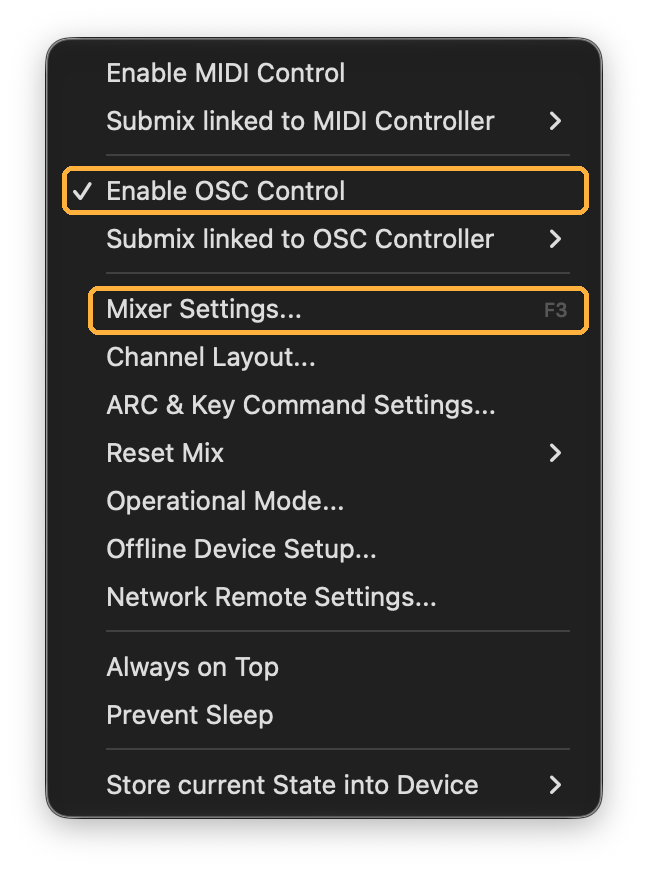
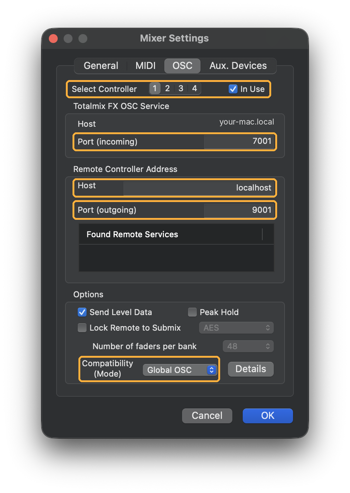
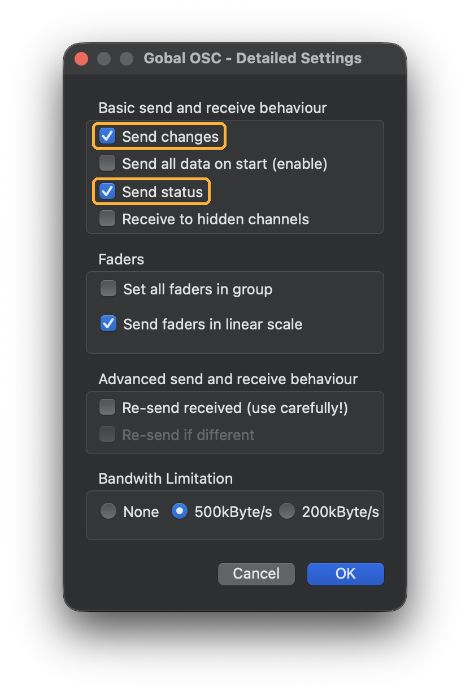
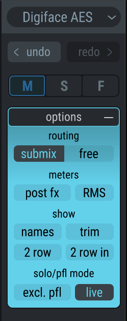
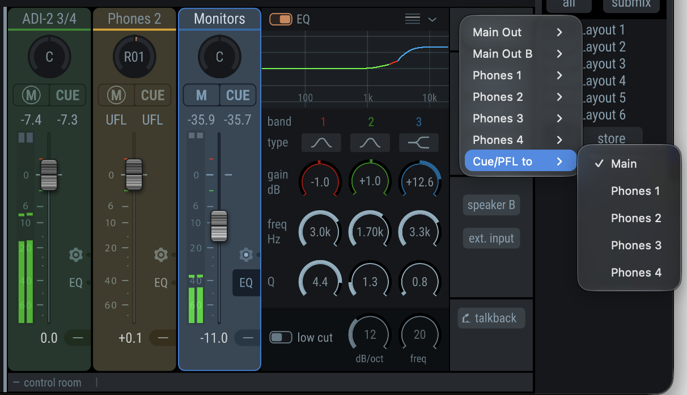
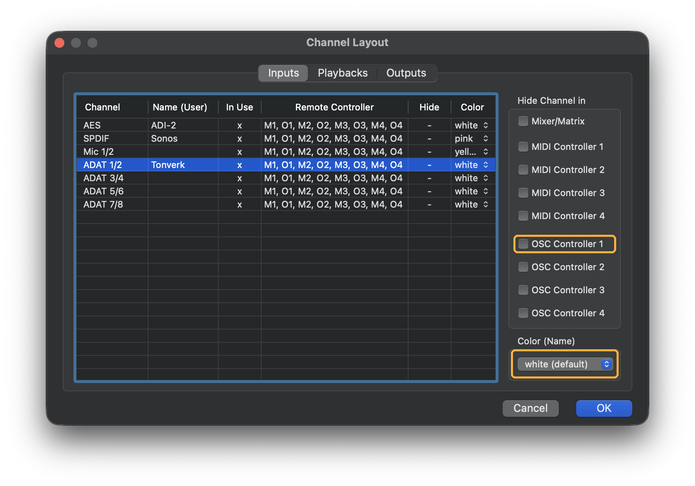

# Setting up Performance Bridge

## What you need

- A Mac running macOS 13 or later.
- TotalMix FX 2.1 or later (release candidates included), on a supported RME interface. Earlier versions don't have Global OSC; the Setup Guide checks the version. Tested only with a Digiface AES.
- A hardware controller, connected to the Mac by USB: a Roto-Control (tested with firmware 3.3.0), a Launch
  Control XL 3 (tested with firmware 1.2), or a Launch Control 3 (not yet tried on a device).
- Performance Bridge 1.0.0 or later, from the [latest release](https://github.com/adambier/performance-bridge/releases/latest),
  moved to the Applications folder. (To run it from source instead, see the README, "Running the app
  from source".)

Open **Performance Bridge** from the Applications folder. It runs in the menu bar, with no Dock icon. Its
Setup Guide window follows these steps and checks each one live where it can: whether TotalMix FX answers,
whether it has sent its channels, whether meters arrive, and whether the hardware controller is connected. It
opens by itself the first time the app runs; after that, choose **Setup Guide…** from the menu.

## Step 1: Turn on Global OSC in TotalMix FX

Checked on screen with TotalMix FX "2.10 (1)" on a Mac (2026-10-31); the screenshots are from it.

1. Open TotalMix FX's **Options** menu and check **Enable OSC Control**. (RME's online manual calls the item
   "Enable MIDI / OSC Control", [docs.rme-audio.com](https://docs.rme-audio.com/aoxd/818-1c_menu_options/); the running TotalMix FX shows "Enable
   OSC Control" and a separate "Enable MIDI Control".)

   

2. Choose **Options → Mixer Settings…** (shortcut F3) and open the **OSC** tab.
3. Under **Select Controller**, choose an OSC Controller (1–4) for Performance Bridge and check **In Use**.
   - Each program or device that connects to TotalMix FX over OSC (e.g., Performance Bridge, a tablet app, or
     another remote) needs its own OSC Controller and its own ports.
   - OSC Controller 1 is shown below, with incoming 7001 and outgoing 9001. If another program already uses OSC
     Controller 1, choose another and give it ports no other OSC Controller uses (for example, 7002 and 9002).
4. Under **Compatibility (Mode)**, choose **Global OSC**.
5. Set the ports:
   - **Port (incoming)**, under "Totalmix FX OSC Service" (TotalMix FX's capitalization), is where Performance
     Bridge sends to TotalMix FX. The **Host** above it is your Mac's own name, shown for reference.
   - Under **Remote Controller Address**, **Host** is the computer Performance Bridge runs on (`localhost` or
     `127.0.0.1` on the same Mac), and **Port (outgoing)** is where TotalMix FX sends to Performance Bridge.
   - Enter the same two ports in Performance Bridge's **Settings… → Connections**. Its defaults are 7001 and
     9001, which RME's manual gives as typical values.

   

6. In the OSC tab's **Options** group, check **Send Level Data** for meters on the hardware controllers and leave **Lock Remote
   to Submix** off (Performance Bridge chooses submixes itself). The effect of **Number of faders per bank** on
   the app has not been tested.
7. Click **Details**, which opens "Gobal OSC - Detailed Settings" (TotalMix FX's spelling), and check **Send
   changes** and **Send status**. The other settings shown are the ones used in the tests: "Send all data on
   start (enable)" off, "Receive to hidden channels" off, "Set all faders in group" off, "Send faders in linear
   scale" on (TotalMix FX accepts both scales, test 2), "Re-send received (use carefully!)" off, and "Bandwith
   Limitation" (TotalMix FX's spelling) at 500kByte/s. Whether the app needs
   any of them set a certain way has not been tested.

   

8. Leave **Options → Submix linked to OSC Controller** as it is. It is a submenu with one item per OSC
   Controller, 1 to 4; all four were checked on the test Mac. RME's Global OSC document says "Follow Submix"
   should be off with Global OSC; this submenu is inferred to be that setting, since TotalMix FX has no item by
   that name. The tests ran with it checked and Global OSC worked (`docs/TOTALMIX-OSC.md`, section 1); a run
   with it unchecked hasn't been compared.
9. **Mute and PFL.** The hardware controllers' mute and PFL buttons depend on three settings in TotalMix FX's
   window, checked on screen:

   

   - **Mute Master.** Turn on the **M** button in the Control Strip, below the interface's name and "undo". While
     it is off, a mute only selects the channel's mute and doesn't silence it (`docs/TOTALMIX-OSC.md`, the global
     mute recheck of 2026-10-31). Performance Bridge reads it: while it is off, the menu shows **Mute Master:
     Off**, the Setup Guide shows a warning, and on a Launch Control a mute that is on flashes.
   - **Live mode.** In the Control Strip, click **options** and, under **solo/pfl mode**, choose **live**. Without
     it, PFL from a hardware controller is accepted but has been observed to show nothing in TotalMix FX's window
     (`docs/TOTALMIX-OSC.md`, test 6). TotalMix FX
     doesn't send this setting over OSC, so Performance Bridge can't check it; the Setup Guide reminds you.
   - **Where PFL goes.** In the Control Room section, click **assign**, then **Cue/PFL to**, and choose a
     headphone output, e.g., **Phones 1** (checked on screen; `docs/TOTALMIX-OSC.md`, test 21). Its
     default, **Main**, makes PFL replace what Main Out plays, so on stage the audience hears only the channel
     being checked (test 6). TotalMix FX doesn't send this setting over OSC (test 21), so Performance Bridge can't check it; the Setup
     Guide reminds you.

     

## Step 2: Choose which channels the hardware controllers show

Hide and show channels in TotalMix FX; Performance Bridge has no setting for hiding. A channel that TotalMix FX
hides from an OSC Controller is not shown on the hardware controllers connected through it, and the app does
not show it grayed out. Checked on screen (2026-10-31) unless marked otherwise.

1. Open TotalMix FX's own **Channel Layout** window: right-click a channel's strip and choose **Change Channel
   Layout**, or choose **Options → Channel Layout…**. It has tabs for Inputs, Playbacks, and Outputs.
2. Select the channel's row. Under **Hide Channel in**, check the **OSC Controller** box for the OSC Controller
   Performance Bridge uses (e.g., OSC Controller 1). Hiding from one OSC Controller doesn't affect the others or
   the Mixer/Matrix.
3. Channel colors can be set in the same window, in the **Color** column or with **Color (Name)** below the
   boxes. The Roto-Control shows them too.

   

4. Then choose **Refresh Channels from TotalMix FX** in Performance Bridge's menu: TotalMix FX doesn't announce
   hidden or shown channels over OSC (`docs/TOTALMIX-OSC.md`, test 11). The app also refreshes by itself when
   its Channel Layout tab opens and when TotalMix FX comes back after going quiet.

The Channel Layout window's **Remote Controller** column lists M1–M4 and O1–O4 for each channel when nothing is hidden; what it
shows for a hidden channel has not been checked. Hiding has been observed not to renumber the other channels (one
run).

## Step 3: Connect the hardware controller

Performance Bridge uses one hardware controller at a time: a Roto-Control, a Launch Control XL 3, or a
Launch Control 3.

1. Connect the hardware controller to the Mac by USB. It can be connected before or after the app starts.
2. In Performance Bridge, open **Settings… → Connections** and choose it from the **Controller** menu
   under Hardware Controller. The Roto-Control is the default.
3. Click **Apply**, just below the menu. Apply, **Revert**, and **Defaults** cover the TotalMix FX connection (host
   and ports) and the hardware controller; the send rows below them don't need Apply.

The app finds the controller by the names of its MIDI ports, which are fixed for each model, so there is
no port to choose: the Roto-Control's port "Roto-Control", and a Launch Control's DAW ports ("LCXL3 1 DAW
In" and "Out" on a Launch Control XL 3, "LC3 1 DAW In" and "Out" on a Launch Control 3, the number being
the device ID). With more than one Launch Control of the same model connected, it uses the one with the
lowest device ID.

With a Launch Control chosen, the Connections tab also shows its send rows below Apply. Their outputs can
be chosen there at any time while TotalMix FX is open, with the Launch Control connected or not, and a
change takes effect at once (Step 6).

## Step 4: Check the connections

The menu-bar icon's menu starts with two status lines, dimmed because they only report. The app keeps trying
to connect whatever they show:

- **TotalMix FX: Connected** means TotalMix FX has answered. **No Answer** means it has not yet; the app asks
  again every 3 seconds. **Port N in Use** means another program is using TotalMix FX's outgoing port
  (Step 1), so quit that program (e.g., `sbdev` or another OSC remote).
- **Roto-Control: Connected** means the handshake is complete. **Connecting** means the device was found and
  the handshake is under way. **Not Found** means no Roto-Control is connected.
- With a Launch Control chosen, its line takes the Roto-Control's place: **Launch Control XL 3: Connected**
  means the device has entered DAW mode, **Connecting** that its DAW port is open and the app is asking for
  DAW mode, and **Not Found** that no Launch Control of the model chosen in Settings is connected.

One more line appears only while TotalMix FX's Mute Master is off (Step 1, item 9): **Mute Master: Off**.

### The menu-bar icon

The Setup Guide also opens by itself, at most once per launch, for a problem that has never worked with
the current settings: the port in use; TotalMix FX running but not answering for 30 seconds; or the
hardware controller plugged in but not connected after 15 seconds. A hardware controller that isn't
plugged in, or TotalMix FX not running, never opens it.

Once a connection has worked, a fault only puts a red dot on the menu-bar icon, so a window never
takes the focus during a performance. The dot is for faults: the port in use, TotalMix FX running but
silent for 10 seconds, or the hardware controller plugged in but not connected for 10 seconds.
When TotalMix FX is closed or the hardware controller is unplugged, the app is idle and shows no dot, so
it can be left running all the time. The icon is dimmed whenever TotalMix FX or the hardware controller isn't connected and
drawn normally when both are; a fault shows the red dot on the dimmed icon.

### The log

The app also writes the full reason for any state to a log. To see it, quit the app and start it from
Terminal instead:

```
"/Applications/Performance Bridge.app/Contents/MacOS/PerformanceBridge"
```

## Step 5: Set the layout

Choose **Settings…** from the menu and open the **Channel Layout** tab.

- The **Sources** and **Outputs** buttons switch between the two lists.
- **Sources** are the channels the hardware controllers show. Drag a channel to change its place on them.
- **Playbacks start on a new page**, under the Sources list, puts the first playback at the start of a new
  page of strips, after blank strips that fill the inputs' last page.
- **Outputs** are the outputs the send controls can feed (Step 6). Their order is the order you step through
  them on the hardware controllers. The **Control Room** outputs (those assigned in TotalMix FX's control room:
  Phones, and so on) and the **Hardware Outputs** are ordered in their own sections, since control room outputs
  always come first.
- Click a channel's name to give it a **label** for the hardware controllers, e.g., a short name for mixing. The label shows only on the hardware controllers; TotalMix FX keeps its own name, shown dimmed beside the label. Clear the label to show TotalMix FX's name again. A playback without a label shows as "PB 1/2" and so on, since an unnamed playback otherwise has its output's hardware name, which can be the same as an input's.
- The order and the labels are kept when Performance Bridge restarts.
- **Restore TotalMix FX Order** puts the view back in TotalMix FX's order. It is dimmed when the order is already TotalMix FX's.
- To take a channel off the hardware controllers, hide it in TotalMix FX (Step 2). The layout has no hide setting of its own.
- Set channel colors in TotalMix FX's own Channel Layout window (Step 2).
- The note at the bottom repeats the rule for channels hidden in TotalMix FX.

## Step 6: Use the hardware controllers

Every hardware controller works the same way: **each column of controls is one channel**, and every control in a
column controls that channel. Levels and pans go into the submix of the output that TotalMix FX's control room
assigns to Main Out and follow Main Out if it is reassigned there. Set the outputs themselves (e.g., Main Out's volume
and Speaker B) in TotalMix FX or with an ARC USB; the hardware controllers don't change them.

**Sends** set the headphone mixes and the other submixes. A send control sets how much of its channel goes to one other output, e.g.,
Phones 1. A row of send controls is that output's whole submix, one channel per column. The outputs a send row can
feed are the ones in Settings → Channel Layout → Outputs, in that order, except Main Out and Main Out B (they carry
the main mix) and the cue output (PFL uses it).

### Launch Control XL 3

| Control (in each column) | What it does for that column's channel |
|---|---|
| Fader | Level in Main Out. The ticks read +6, +3, 0, −6, −10, −20, −40, −60, and −oo, as on TotalMix FX's faders. |
| Top encoder | Send to the top row's output (e.g., Phones 1) |
| Middle encoder | Send to the middle row's output (e.g., Phones 2) |
| Bottom encoder | Pan in Main Out |
| Top button | PFL (bright yellow when on, dim yellow when off) |
| Bottom button | Mute (bright orange when on, dim orange when off; a mute that is on flashes while TotalMix FX's Mute Master is off) |

| Button | What it does |
|---|---|
| **Track >** / **Track <** | Show the next or previous eight channels. With **Shift**: the last or first eight. |
| **Page ▼** / **Page ▲** | Change the output the **top** encoder row feeds, to the next or previous one in the Outputs list. |
| **Shift + Page ▼** / **▲** | The same for the **middle** encoder row. |
| **Shift + turn an encoder** | Reset it: a pan to the center, a send to −oo (release Shift, then Shift + turn it again to bring it back). Hold Shift for a moment (0.3 s) first; after Page or Track in the same hold, turning does nothing. |

- The two send rows never feed the same output: stepping one skips the output the other has.
- The screen shows the channels on the page, counted in the order of Settings → Channel Layout with a stereo pair
  counting once, and where each send row goes (e.g., "Inputs 1-7", "Top > Phones 1",
  "Mid > Phones 2"). Moving a control shows its channel, what it does, and its value. After each Page press the
  screen names the row and its new output, and each send row's lights take the color of the output it feeds.
- Page and Track are lit where they can move and dark at the ends. While Shift is held, Page lights for the middle
  row.
- Each row's output is remembered when Performance Bridge restarts. It can also be chosen in Settings, at the
  bottom of the Connections tab, with the Launch Control connected or not; the change takes effect at once.
- Press **Track <** and **Track >** together to go back to the first eight channels.
- Solo/Arm, Mute/Select, Record, Play, and the Novation button do nothing in this release; they are kept free for
  later uses (e.g., a connection to a DAW).
- Level and pan are Main Out's. In TotalMix FX each submix has its own level and pan for every channel, so TotalMix FX's
  window shows the pans set here only while Main Out's output is selected in its bottom row (observed 2026-11-01).

### Launch Control 3

The Launch Control 3 works the same way, with fewer controls:

| Control (in each column) | What it does for that column's channel |
|---|---|
| Bottom encoder | Level in Main Out |
| Top encoder | Pan, or a send: **Page ▼** / **▲** steps it through Pan, then each output in the Outputs list |
| Button | Mute; PFL while **Function** (labeled "DAW" underneath) is held (orange for mute, yellow for PFL, dim when off; Function rests dim yellow and lights bright yellow while held) |

Track works as on the XL 3, and Shift + turn resets an encoder as it does there; a level above 0 dB comes down to 0 dB,
and one at or below 0 dB stays. The screen shows the channels on
the page, the top row's function (e.g., "Top: Pan"), and the buttons' ("Buttons: Mute"; briefly "Buttons" over "PFL" while Function is held). The Launch Control 3 has not been tried on a device yet (`docs/LAUNCH-CONTROL-3.md`).

### Roto-Control

Each of the eight knobs is a channel. Hold **SEL** to choose what the knobs control (Volume, Pan, or a send, "FX")
and what the switches do (Mute or Solo; Solo is PFL here). The < and > buttons page through the channels. Pressing
both arrow buttons together switches the Roto-Control to its second track set ("MIX-RTN" on its screen), which shows
the same channels.

## If something does not work

- **TotalMix FX: Port N in Use.** Another program has the port. Quit `sbdev` or any other OSC remote.
- **TotalMix FX: No Answer.** Check that Global OSC is on and that the ports in Settings match TotalMix FX's
  (Step 1). Then choose **Refresh Channels from TotalMix FX**.
- **Roto-Control or Launch Control: Not Found.** Check the cable, and that the model chosen in Settings is the
  one connected (Step 3).
- **A channel is missing from the hardware controllers.** Check whether TotalMix FX hides it from the OSC Controller the app uses
  (Step 2).

## Reporting a problem

Report problems as [issues on GitHub](https://github.com/adambier/performance-bridge/issues). Start the app
from Terminal (Step 4 shows how) and include its log: the app writes every connection event to it.
